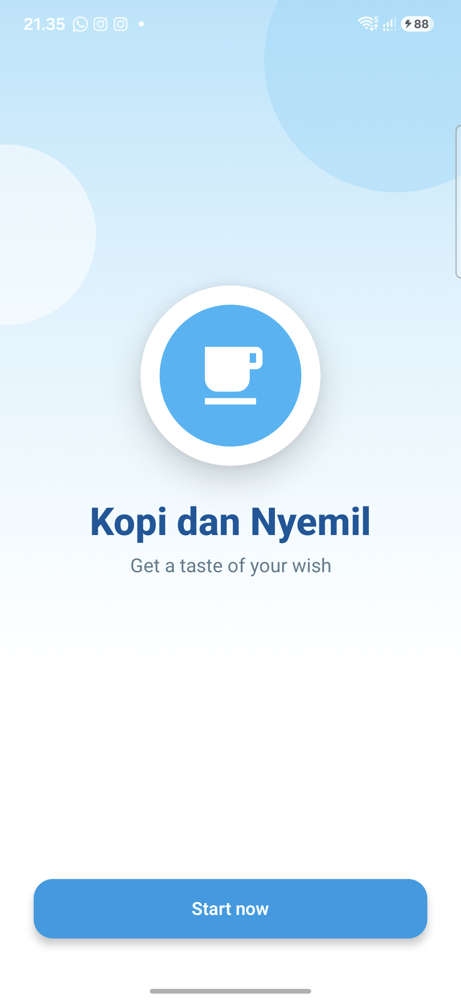
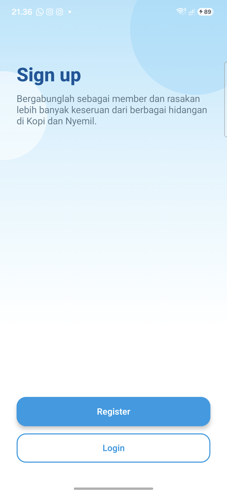
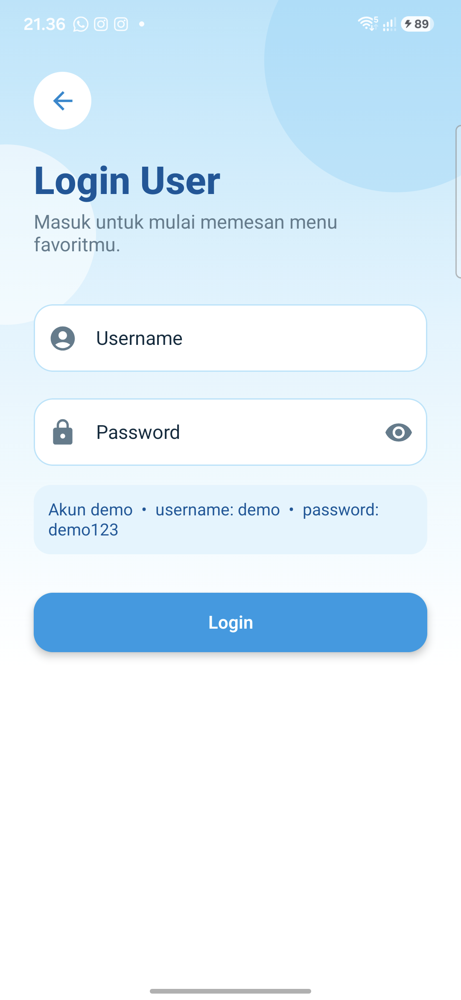
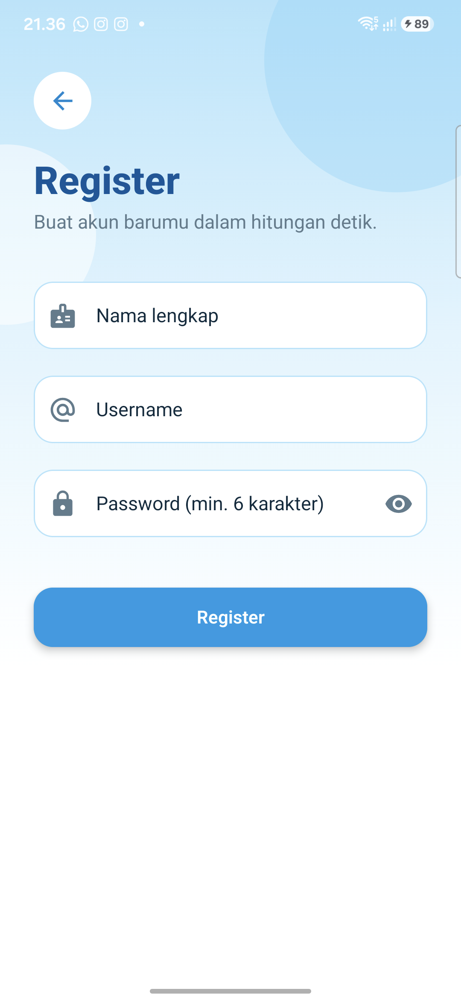
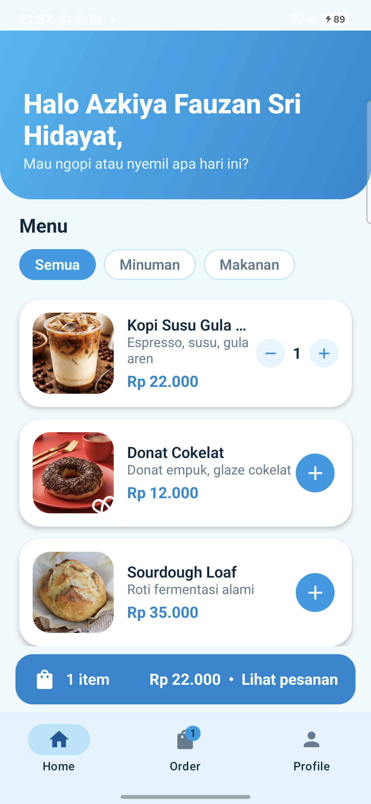
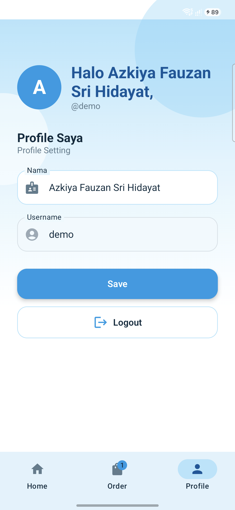
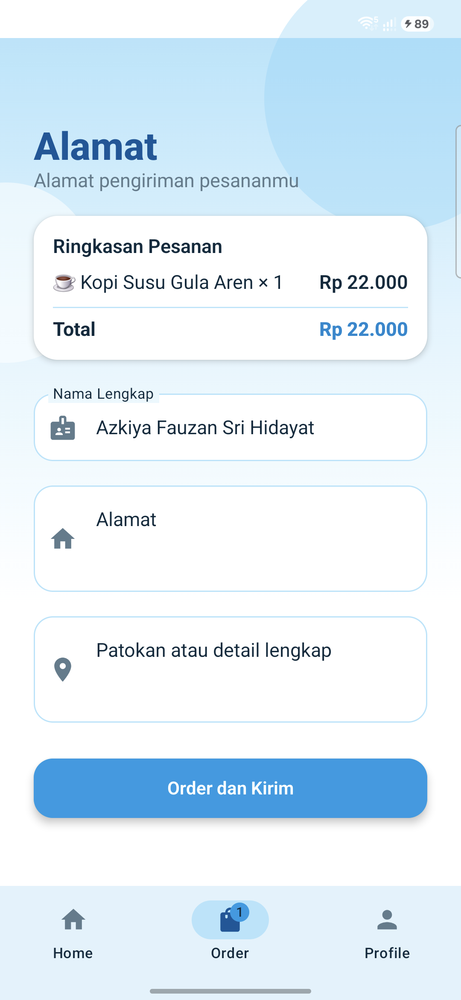
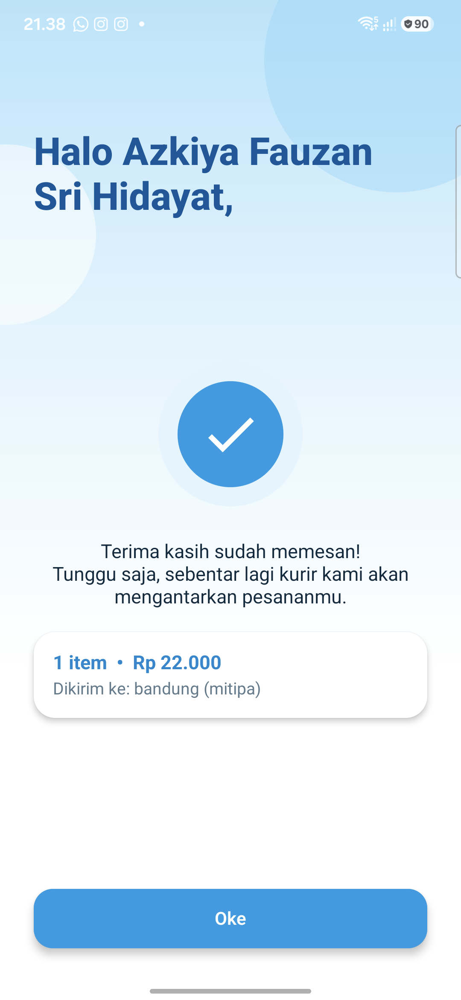

# ☕ Kopi dan Nyemil

Aplikasi mobile pemesanan kopi dan camilan berbasis **Android (Kotlin)** dengan **View-based UI (XML Layout)**
dan tema **biru muda dan putih**. Dibuat untuk tugas mata kuliah **Pengembangan Aplikasi Mobile**
berdasarkan wireframe "Kopi dan Nyemil".

> Tagline: *Get a taste of your wish*

## 📱 Deskripsi
Pengguna dapat mendaftar atau login, melihat daftar makanan dan minuman, menambahkan pesanan ke
keranjang, mengisi alamat pengiriman, lalu menerima konfirmasi pesanan. Seluruh data bersifat
**statis (dummy)** dan disimpan di memori, **tanpa database**.

## ✨ Fitur
- **Splash / Welcome** dengan animasi logo
- **Sign Up** (pilihan Register atau Login)
- **Login** dengan validasi (akun demo tersedia)
- **Register** dengan validasi (nama, username unik, password minimal 6 karakter)
- **Home**: sapaan nama pengguna, filter kategori (Semua / Minuman / Makanan), 7 menu dengan foto, tombol tambah/kurang jumlah, dan bar ringkasan keranjang
- **Profile**: lihat dan ubah nama, simpan, logout
- **Alamat Pengiriman (Order)**: ringkasan pesanan dan total, form nama, alamat, dan patokan
- **Konfirmasi Pesanan**: animasi centang dan ringkasan order
- **Bottom Navigation** (Home / Order / Profile) dengan badge jumlah item

## 🛠️ Teknologi
- Kotlin
- **View-based UI** (XML Layout) dengan **ViewBinding**
- Activity dan Fragment
- Material Components (MaterialButton, TextInputLayout, Chip, BottomNavigationView, CardView)
- RecyclerView + Adapter untuk daftar menu
- Coil (memuat gambar menu)
- Android Gradle Plugin 8.5, minSdk 26, targetSdk 34

## 🚀 Cara Menjalankan

### Kebutuhan
- **Android Studio** versi terbaru
- **JDK 17** (bisa diunduh lewat Android Studio: *Settings → Build Tools → Gradle → Gradle JDK → Download JDK*)
- Koneksi internet saat pertama kali membuka project (untuk mengunduh dependency Gradle)
- Emulator Android atau HP Android dengan **Android 8.0 (API 26) ke atas**

### Langkah 1: Buka project
1. Ekstrak file project (jika dalam bentuk `.zip`).
2. Buka **Android Studio**, pilih **File → Open**, lalu pilih folder **KopiDanNyemil**.
3. Tunggu proses **Gradle Sync** selesai. Build pertama bisa memakan waktu 5 sampai 15 menit.

### Langkah 2: Siapkan perangkat

**Opsi A: Emulator**
1. Buka **Device Manager** (ikon HP di sisi kanan Android Studio).
2. Klik **Create Device**, pilih perangkat seperti **Pixel 6**, lalu pilih system image **API 34** dan klik **Finish**.
3. Klik tombol ▶ pada emulator untuk menyalakannya.

**Opsi B: HP Android asli**
1. Buka **Settings → About Phone**, lalu ketuk **Build Number** 7 kali untuk mengaktifkan Developer Options.
2. Aktifkan **USB Debugging** di *Developer Options*.
3. Hubungkan HP ke laptop dengan kabel USB dan pilih **Allow** pada pop-up di HP.

### Langkah 3: Jalankan aplikasi
1. Pilih perangkat tujuan pada dropdown device di toolbar atas Android Studio.
2. Klik tombol **Run ▶** (atau tekan **Shift + F10**).
3. Tunggu proses build dan instalasi. Aplikasi akan terbuka otomatis.

### Langkah 4: Menggunakan aplikasi
1. Di layar **Splash**, tekan **Start now**.
2. Di layar **Sign Up**, pilih **Login** atau **Register**.
   - **Login** memakai akun demo: username `demo`, password `demo123`.
   - **Register** untuk membuat akun baru (nama lengkap, username, dan password minimal 6 karakter).
3. Di **Home**, pilih kategori (Semua / Minuman / Makanan), lalu tekan **+** untuk menambahkan menu ke keranjang.
4. Tekan bar keranjang di bawah atau tab **Order** untuk membuka halaman **Alamat**.
5. Isi **Nama Lengkap**, **Alamat**, dan **Patokan**, lalu tekan **Order dan Kirim**.
6. Halaman **Konfirmasi** muncul. Tekan **Oke** untuk kembali ke Home.
7. Buka tab **Profile** untuk mengubah nama atau **Logout**.

### Kendala Umum
| Masalah | Solusi |
|---|---|
| Error `IllegalArgumentException: 25.0.2` saat build | Ganti Gradle JDK ke **JDK 17** di *Settings → Build Tools → Gradle*, lalu **Clean Project** dan **Rebuild Project** |
| Gradle Sync gagal | Pastikan internet aktif, lalu klik **File → Sync Project with Gradle Files** |
| Error `Unresolved reference: kopi_susu_gula_aren` | Pastikan 7 foto menu ada di `app/src/main/res/drawable/` dengan nama file yang sesuai |
| Emulator sangat lambat | Gunakan emulator lebih ringan (Pixel 6, API 34) atau jalankan di HP asli |

## 🖼️ Foto Menu
Foto disimpan di `app/src/main/res/drawable/` dengan nama:
`kopi_susu_gula_aren`, `donat_cokelat`, `sourdough_loaf`, `cappuccino`, `matcha_latte`,
`croissant_butter`, `es_cokelat` (format `.jpg`, `.jpeg`, atau `.png`).

## 🔄 Alur Aplikasi
`Splash → Sign Up → Login / Register → Home → (Order) Alamat → Konfirmasi → Home`

`Home ⇄ Order ⇄ Profile` melalui bottom navigation.

## 📸 Screenshot

### Splash, Sign Up, Login, dan Register
| Splash | Sign Up | Login | Register |
|:---:|:---:|:---:|:---:|
|  |  |  |  |

### Home, Profile, Alamat, dan Konfirmasi
| Home | Profile | Alamat | Konfirmasi |
|:---:|:---:|:---:|:---:|
|  |  |  |  |

## 📁 Struktur Project
```
app/src/main/
├── java/com/kopidannyemil/app/
│   ├── data/
│   │   ├── Models.kt            # model dan dummy data menu
│   │   └── AppRepository.kt     # data user, keranjang, order (in-memory)
│   └── ui/
│       ├── SplashActivity.kt
│       ├── SignUpActivity.kt
│       ├── LoginActivity.kt
│       ├── RegisterActivity.kt
│       ├── MainActivity.kt      # host fragment + bottom navigation
│       ├── HomeFragment.kt      # daftar menu
│       ├── MenuAdapter.kt       # adapter RecyclerView
│       ├── OrderFragment.kt     # alamat pengiriman
│       ├── ProfileFragment.kt
│       └── ConfirmationActivity.kt
└── res/
    ├── layout/                  # layout XML tiap halaman
    ├── drawable/                # ikon, background, foto menu
    ├── values/                  # warna, tema, style
    └── menu/bottom_nav.xml
```

## 👤 Author
- Nama : _isi nama_
- NIM  : _isi NIM_
